# Poiesis Ansh

*Poiesis* means creation. *Ansh* means share or contribution.

The project measures each factor's declared contribution to a generated image.

This directory contains a complete, deterministic toy experiment comparing mutual-information decomposition, exact Shapley allocation, and a cross-attention-style mechanistic probe for prompt-conditioned image generation.

Run:

```bash
/Users/evam/.cache/codex-runtimes/codex-primary-runtime/dependencies/python/bin/python3 experiment.py
```

Then read [`REPORT.md`](REPORT.md). Generated files are written to `artifacts/`.

Run the robustness study:

```bash
/Users/evam/.cache/codex-runtimes/codex-primary-runtime/dependencies/python/bin/python3 robustness.py
```

Then read [`CRITIQUE_AND_RD.md`](CRITIQUE_AND_RD.md).

Run the exact Gaussian spectral benchmark:

```bash
/Users/evam/.cache/codex-runtimes/codex-primary-runtime/dependencies/python/bin/python3 spectral_theory.py
```

Then read [`NEURAL_REDSHIFT_EXTENSION.md`](NEURAL_REDSHIFT_EXTENSION.md).

Run the random-function architecture pilot:

```bash
/Users/evam/.cache/codex-runtimes/codex-primary-runtime/dependencies/python/bin/python3 architecture_prior.py
```

Run its tests:

```bash
/Users/evam/.cache/codex-runtimes/codex-primary-runtime/dependencies/python/bin/python3 -m unittest discover -s tests
```

The real Stable Diffusion experiment is in [`real_model/`](real_model/README.md).
Its methods and sources are reviewed in [`REAL_MODEL_LITERATURE_REVIEW.md`](REAL_MODEL_LITERATURE_REVIEW.md).
Its completed pilot report is [`REAL_MODEL_REPORT.md`](REAL_MODEL_REPORT.md).

The transparent experiment requires only NumPy and Pillow.
It tests estimators in a learned-prior generator.
It does not measure legal ownership or directly attribute fixed neural-network weights.

## Project architecture

The repository is organised into the toy attribution experiments, analytical
benchmarks, and the real Stable Diffusion studies. The architecture diagram
below shows the main scripts, shared runtime, low-rank tools, activation
patching path, and pinned checkpoint.


The editable Mermaid source is available at
[`docs/project-architecture.mmd`](docs/project-architecture.mmd). It was
generated from the repository structure and links study nodes to their source
files on GitHub.

```mermaid
flowchart TD

subgraph group_toy["Toy Attribution"]
  node_toyexperiment["Exact Toy Experiment<br/>[experiment.py]"]
  node_toyprior["Learned Scene Prior<br/>[experiment.py]"]
  node_toymeasure["MI and Shapley<br/>[experiment.py]"]
  node_toyprobe["Attention Probe<br/>[experiment.py]"]
end

subgraph group_analysis["Attribution Studies"]
  node_robustness["Robustness Checks<br/>[robustness.py]"]
  node_spectral["Gaussian Spectral Benchmark<br/>[spectral_theory.py]"]
  node_architecture["Architecture Prior Pilot"]
end

subgraph group_real["Stable Diffusion Studies"]
  node_realreadme["Real Model Experiments<br/>[README.md]"]
  node_baseline["Baseline Generation<br/>[run_baseline.py]"]
  node_patchrun["Activation Patching Study"]
  node_patchtools["Activation Recorder and Patcher"]
  node_seedstudy["Seed Robustness Study"]
  node_weightstudy["Weight Direction Study"]
  node_gradientstudy["Gradient-Aligned LoRA"]
  node_outputgradient["Output Weight Gradients"]
  node_trainedlora["Trained LoRA Study"]
  node_weighttools["Low-Rank Weight Tools<br/>[weight_tools.py]"]
end

subgraph group_shared["Real Model Runtime"]
  node_runtime["Model Loading and Generation<br/>[model_utils.py]"]
end

node_researcher(("Researcher"))
node_checkpoint[("Stable Diffusion Checkpoint")]

node_researcher -->|"runs"| node_toyexperiment
node_toyexperiment -->|"learns prior"| node_toyprior
node_toyexperiment -->|"computes attribution"| node_toymeasure
node_toyexperiment -->|"probes routing"| node_toyprobe
node_researcher -->|"runs checks"| node_robustness
node_robustness -->|"uses core"| node_toyexperiment
node_researcher -->|"runs benchmark"| node_spectral
node_researcher -->|"runs pilot"| node_architecture
node_architecture -->|"uses benchmark"| node_spectral
node_researcher -->|"runs studies"| node_realreadme
node_realreadme -->|"documents experiment"| node_baseline
node_baseline -->|"loads and generates"| node_runtime
node_patchrun -->|"loads and generates"| node_runtime
node_patchrun -->|"uses hooks"| node_patchtools
node_seedstudy -->|"loads and generates"| node_runtime
node_seedstudy -->|"patches activations"| node_patchtools
node_seedstudy -->|"uses directions"| node_weighttools
node_weightstudy -->|"loads and generates"| node_runtime
node_weightstudy -->|"builds directions"| node_weighttools
node_gradientstudy -->|"loads and generates"| node_runtime
node_gradientstudy -->|"uses low-rank tools"| node_weighttools
node_outputgradient -->|"loads model"| node_runtime
node_outputgradient -->|"approximates gradients"| node_weighttools
node_outputgradient -->|"reuses helpers"| node_gradientstudy
node_trainedlora -->|"loads and generates"| node_runtime
node_trainedlora -->|"trains adapter"| node_weighttools
node_runtime -->|"loads snapshot"| node_checkpoint
```


